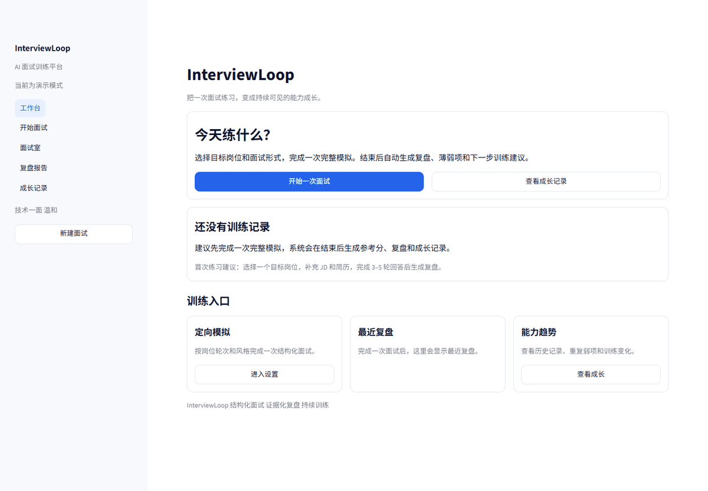

# InterviewLoop

面向技术岗位的多轮自适应 AI 面试训练平台。它将简历、面试轮次、阶段状态机、动态追问、语音/文字作答、结构化复盘和完整记录导出连接成一个可重复训练、可回顾的闭环。



> 当前状态：MVP。核心面试流程、模块化结构、pytest 测试、GitHub Actions、Docker 运行方式、Mock Demo 和演示素材已经具备。

## 项目解决什么问题

传统面试准备通常依赖题库、面经或真人陪练：

- 题库缺少针对个人简历的上下文。
- 通用 AI 聊天缺少稳定的面试流程和阶段控制。
- 真人模拟面试成本高、难预约。
- 面试结束后缺少完整问答记录和可执行的复盘。

InterviewLoop 将一次技术面试拆成轮次、阶段、主问题、追问和时间预算，并在面试完成后自动生成复盘和 Markdown 记录。

## 核心功能

- 五视图产品壳：工作台、三步设置向导、专注面试室、复盘报告、成长记录。
- 版本化场景注册表：岗位族、轮次、阶段、题目计划、时长和 Rubric 配置化。
- JD + 简历匹配：技能提取、匹配度、缺失技能、风险项和针对性出题上下文。
- 结构化复盘：综合得分、维度评分、回答证据、优势风险、行动计划和成长趋势。
- 本地只读平台控制台：场景、模型路由、工具权限、租户额度、AgentRun Trace 和评估指标。
- 4 个面试轮次：技术一面、技术二面、技术三面、HR 面。
- 每轮独立 6 阶段流程，支持主问题、动态追问和时间预算。
- 默认 60 分钟面试，倒计时自动刷新。
- 支持 TXT、Markdown、PDF 简历解析。
- 简历 RAG：本地向量模型可用时使用 FAISS + BM25，否则自动回退 BM25。
- 支持语音回答和文字回答二选一。
- ASR/TTS 接入火山引擎新版豆包语音。
- 大模型接入 DeepSeek OpenAI 兼容接口。
- 重复问题检测和阶段约束。
- 模型网关支持任务级路由、失败重试、Provider 回退、熔断、单轮预算和租户额度。
- 工具运行层支持超时、幂等重试、参数冲突检测、Schema 校验和 AgentRun 审计。
- 支持显式数据同意、PII 脱敏、保留策略、租户存储路径、导出和删除。
- 支持 Trace Replay、质量校准基线、P50/P95 延迟和失败/重试指标。
- 面试结束生成复盘、薄弱标签和完整 Markdown 记录。
- 支持历史记录、弱项统计、跳过阶段和开启新一轮。

## 面试流程

```text
选择轮次和风格
  → 上传简历（可选）
  → 开始 60 分钟面试
  → 当前阶段生成主问题
  → 语音或文字作答
  → 根据回答决定是否追问
  → 主问题完成
  → 阶段完成
  → 生成复盘
  → 保存 JSON + Markdown
```

详细流程见 [docs/interview-flow.md](docs/interview-flow.md)。

## 技术架构

```text
Streamlit UI
  ├── Interview State Machine
  ├── Resume Parser + RAG
  ├── DeepSeek Question / Review Service
  ├── Volcengine ASR / TTS
  ├── Session & Weakness Storage
  └── Markdown Record Export
```

详细说明见 [docs/architecture.md](docs/architecture.md)。

## 快速开始

### 1. 创建虚拟环境

```bash
python -m venv .venv
```

Windows:

```powershell
.\.venv\Scripts\Activate.ps1
```

macOS / Linux:

```bash
source .venv/bin/activate
```

### 2. 安装依赖

```bash
pip install -r requirements.txt
```

### 3. 配置凭证

复制配置模板：

```bash
cp .streamlit/secrets.toml.example .streamlit/secrets.toml
```

然后填写：

- `deepseek_api_key`
- `volc_api_key` 或 `volc_appid` + `volc_token`
- `volc_tts_resource_id`
- `volc_asr_resource_id`
- `volc_voice_type`

也可以使用 `.env.example` 中的同名环境变量。

### 4. 启动应用

```bash
streamlit run app.py
```

浏览器访问：

```text
http://localhost:8501
```

## 配置说明

| 配置 | 用途 |
|---|---|
| `deepseek_api_key` | 大模型出题与复盘 |
| `admin_mode` | 是否启用本地只读平台控制台 |
| `deepseek_base_url` | OpenAI 兼容接口地址 |
| `deepseek_model` | 模型名称 |
| `volc_api_key` | 新版豆包语音 API Key 单头模式 |
| `volc_appid` / `volc_token` | AppID + AccessToken 双头模式 |
| `volc_tts_resource_id` | TTS 资源版本 |
| `volc_asr_resource_id` | ASR 资源版本 |
| `volc_voice_type` | 发音人 / 音色 ID |
| `llm_max_tokens_per_run` | 单轮面试模型 Token 预算 |
| `llm_max_cost_per_run` | 单轮面试模型成本预算（人民币估算） |
| `llm_input_cost_per_million` | 输入 Token 单价，元 / 百万 Token |
| `llm_output_cost_per_million` | 输出 Token 单价，元 / 百万 Token |
| `llm_circuit_failure_threshold` | Provider 熔断失败阈值 |
| `llm_circuit_cooldown_seconds` | Provider 熔断冷却时间 |
| `llm_tenant_max_tokens` | 租户滚动 Token 额度 |
| `llm_tenant_max_cost` | 租户滚动成本额度（人民币估算） |
| `llm_tenant_quota_window_seconds` | 租户额度窗口秒数 |

## 本地数据

运行时会生成：

- `interview_sessions/`：JSON 会话数据。
- `面试记录/`：Markdown 完整面试记录。
- `weak_stats_mode.json`：分轮次弱项统计。

这些文件已默认加入 `.gitignore`，不应提交到公开仓库。

## Architecture Decisions

- [ADR-001: Deterministic workflow](docs/adr/0001-deterministic-workflow-vs-autonomous-agent.md)
- [ADR-002: Hybrid RAG with BM25 fallback](docs/adr/0002-hybrid-rag-with-bm25-fallback.md)
- [ADR-003: Model Gateway](docs/adr/0003-model-gateway.md)
- [ADR-004: Modular monolith first](docs/adr/0004-modular-monolith-first.md)
- [ADR-005: Tenant isolation and tool permissions](docs/adr/0005-tenancy-pii-and-tool-permissions.md)
- [ADR-006: Trace, evaluation and regression](docs/adr/0006-trace-evaluation-and-regression.md)
- [ADR-007: FastAPI vertical slice](docs/adr/0007-fastapi-vertical-slice.md)
- [ADR-008: SQLite-first persistence](docs/adr/0008-sqlite-first-persistence.md)
- [ADR-009: API auth and tool permissions](docs/adr/0009-api-auth-and-tool-permissions.md)
- [ADR-010: SSE event streaming](docs/adr/0010-sse-event-streaming.md)
- [ADR-011: Golden dataset and retrieval metrics](docs/adr/0011-golden-dataset-and-retrieval-metrics.md)
- [ADR-012: Model routing, budgets and telemetry](docs/adr/0012-model-routing-budgets-and-telemetry.md)
- [ADR-013: Tool execution runtime](docs/adr/0013-tool-execution-runtime.md)
- [ADR-014: Versioned scenario registry](docs/adr/0014-versioned-scenario-registry.md)
- [ADR-015: Job description and resume matching](docs/adr/0015-job-description-resume-matching.md)
- [ADR-016: Structured report and growth loop](docs/adr/0016-structured-report-and-growth-loop.md)
- [ADR-017: Minimal read-only control plane](docs/adr/0017-minimal-read-only-control-plane.md)

## 当前局限

- 当前是单机 MVP，没有账号和多租户数据隔离。
- 使用本地文件存储，不适合直接公开 SaaS 部署。
- 质量基线已经建立，但样本仍为小规模合成集，需要真实面试官标注扩容。
- 没有支付、订阅、配额和滥用防护。
- 公开在线 Demo 会产生第三方 API 成本，因此仓库优先提供本地运行和录屏演示。

## Roadmap

- [x] 拆分 `core`、`services`、`rag`、`storage` 和 `export` 模块。
- [x] 增加 pytest 纯逻辑测试和 GitHub Actions。
- [x] 增加 Dockerfile 和环境变量模板。
- [x] 增加 Mock Demo 模式。
- [x] 增加演示截图和流程 GIF。
- [x] 增加模型网关重试、Provider 回退和单轮成本预算。
- [x] 增加工具运行层超时、幂等、权限、Schema 与审计。
- [x] 增加熔断、租户额度、PII、保留策略、导出和删除。
- [x] 增加质量基线、Trace Replay 和 Agent 指标汇总。
- [x] 完成产品化第 1 步：五视图信息架构、三步设置向导和统一主题。
- [x] 完成产品化第 2 步：场景模型、配置包、注册表和共享 API。
- [x] 完成产品化第 3 步：JD + 简历匹配、差距分析和针对性出题。
- [x] 完成产品化第 4 步：结构化复盘、行动计划、成长趋势和旧记录兼容。
- [x] 完成产品化第 5 步：受控只读平台控制台。
- [ ] 建立标准评分 Rubric 和评估基准集。
- [ ] 增加账号、数据库、对象存储和用户数据隔离。
- [ ] 增加公测所需的配额、限流、监控和隐私合规能力。

## 免责声明

本项目用于技术面试训练和模拟，不构成真实招聘决策、职业建议或录用承诺。请勿提交真实简历、录音或面试记录到公开仓库。

## 测试

```bash
pip install -r requirements-dev.txt
ruff check .
pytest -q
```

当前测试覆盖场景注册表与配置校验、JD 技能提取与岗位匹配、结构化评分与成长趋势、控制台访问控制与真实数据汇总、状态机、追问判定、问题相似度、复盘标签、Markdown 导出、会话存储、弱项统计、简历编码解析、模型路由/熔断/租户额度、工具超时/幂等/Schema/审计、PII、保留与删除、质量校准、Trace Replay，以及五视图产品壳下的 Streamlit 全阶段流转和旧记录兼容。

## Demo 模式

无需任何 API Key 即可运行完整面试流程：

```bash
demo_mode=true streamlit run app.py
```

Windows PowerShell:

```powershell
$env:demo_mode="true"
streamlit run app.py
```

演示模式会使用固定题目、固定复盘和语音占位数据，不会调用真实模型或语音接口。

## 平台控制台

控制台默认关闭，候选人导航中不会出现管理入口。启用方式：

```bash
admin_mode=true streamlit run app.py
```

控制台为只读视图，展示场景目录、模型路由、工具权限、租户额度、最近 AgentRun Trace 以及 RAG/质量评估指标。

## Agent API

启动 API：

```bash
uvicorn interview_loop.api.main:app --reload
```

接口：

- `GET /health`
- `GET /v1/tools`
- `GET /v1/scenarios`
- `GET /v1/scenarios/{scenario_id}`
- `POST /v1/job-match`
- `POST /v1/agent-runs`
- `GET /v1/agent-runs/{run_id}`
- `POST /v1/agent-runs/{run_id}/start`
- `POST /v1/agent-runs/{run_id}/events`
- `POST /v1/agent-runs/{run_id}/complete`
- `POST /v1/agent-runs/{run_id}/fail`
- `POST /v1/agent-runs/{run_id}/tools/{tool_name}`
- `GET /v1/agent-runs/{run_id}/export`
- `DELETE /v1/agent-runs/{run_id}`
- `GET /v1/metrics`
- `GET /v1/agent-runs/{run_id}/events/stream`（SSE）

OpenAPI 文档：`http://localhost:8000/docs`。

### 工具执行示例

先创建并启动一个 AgentRun，再调用工具：

```http
POST /v1/agent-runs/{run_id}/tools/question.similarity
Content-Type: application/json
X-Tenant-Id: tenant-a
X-User-Id: user-a
X-Permissions: question:read

{
  "arguments": {
    "new_question": "Explain RAG retrieval.",
    "previous_question": "Explain RAG retrieval."
  },
  "idempotency_key": "request-001"
}
```

响应包含 `output`、`attempts`、`duration_ms` 和 `cached`。相同幂等键与相同参数会返回缓存结果；相同键携带不同参数会返回 `409`。工具权限只从请求身份中读取，不能由请求体覆盖。

### API 鉴权与租户

如果在 `.env` 中设置：

```text
INTERVIEWLOOP_API_KEY=your-secret-key
```

所有 `/v1/*` 接口都需要：

```text
X-API-Key: your-secret-key
X-Tenant-Id: tenant-a
X-User-Id: user-a
X-Permissions: record:write,audio:read
```

未设置 API Key 时，默认允许本地开发访问。不同租户无法查询或修改对方的 AgentRun。

当前默认使用 SQLite 持久化 AgentRun 与事件，适合本地开发和 CI；公测阶段应替换为 PostgreSQL，并补充租户权限、迁移和并发控制。

按保留策略清理过期 Run：

```bash
python scripts/purge_expired_runs.py
```

## Evaluation

Golden dataset:

`datasets/rag_golden.json`

Run retrieval metrics:

```bash
python scripts/evaluate_rag.py
```

Metrics:

- Precision@K
- Recall@K
- MRR
- Hit Rate

Weighted rubric scoring is available in `interview_loop/evaluation/rubric.py`.

## Docker 运行

先准备环境变量：

```bash
cp .env.example .env
```

填写 `.env` 后启动：

```bash
docker compose up --build
```

浏览器访问 `http://localhost:8501`。

Docker 不会打包 `.streamlit/secrets.toml`、真实面试记录或本地会话数据。运行时记录通过 volume 保存在宿主机。
