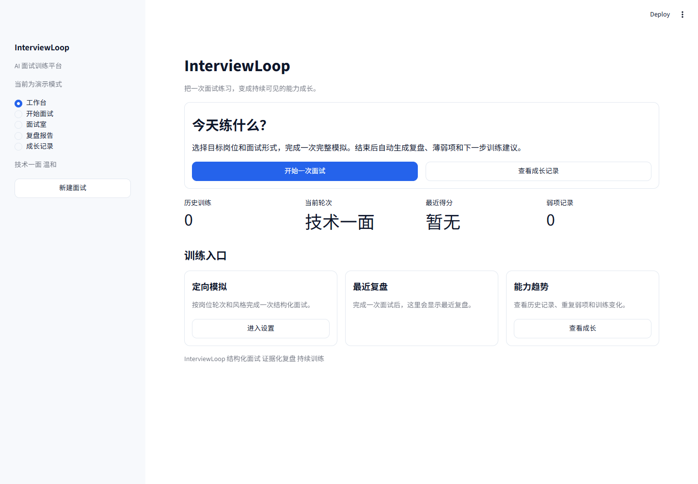
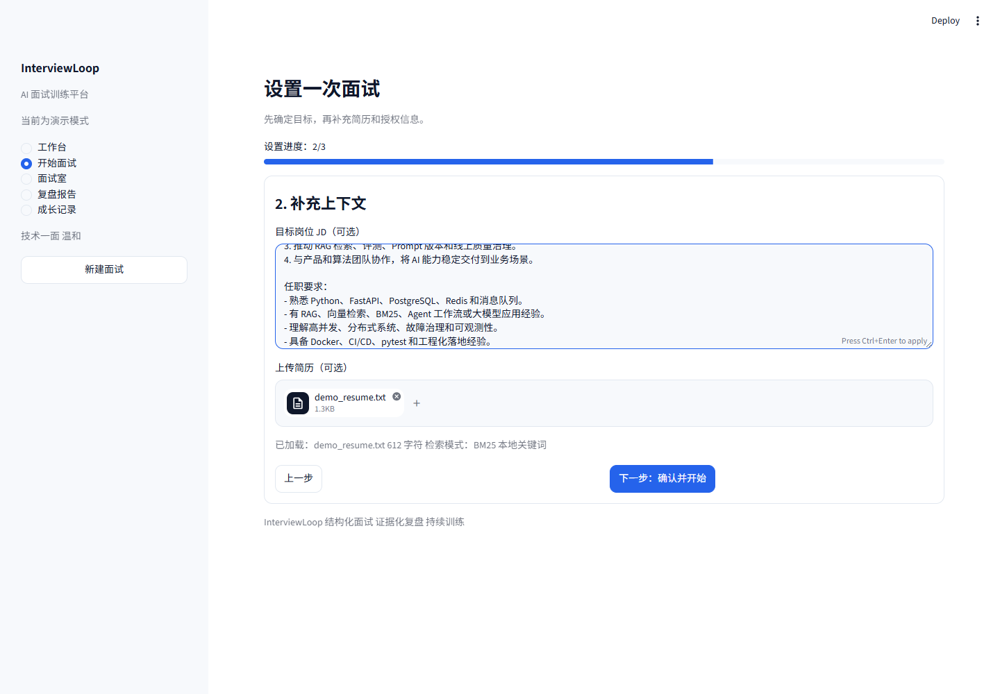
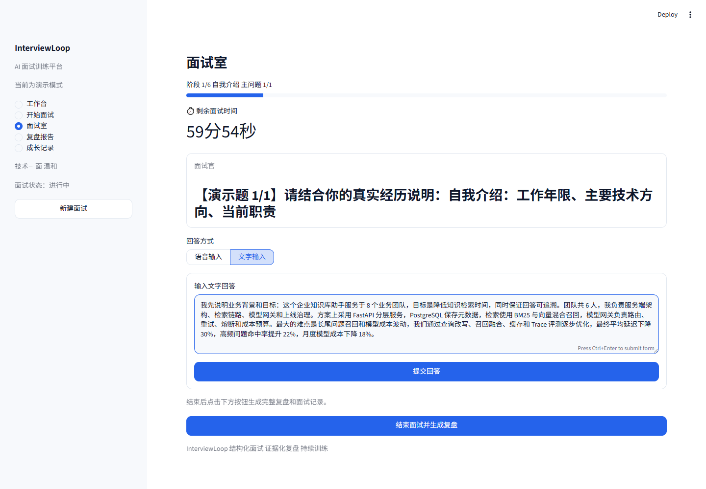
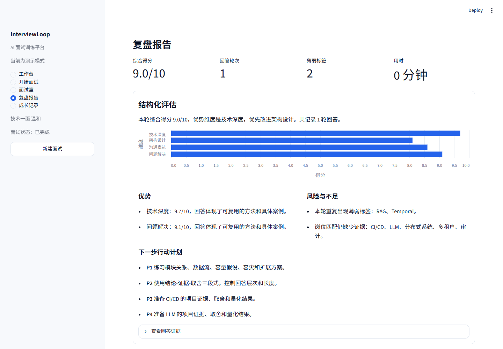
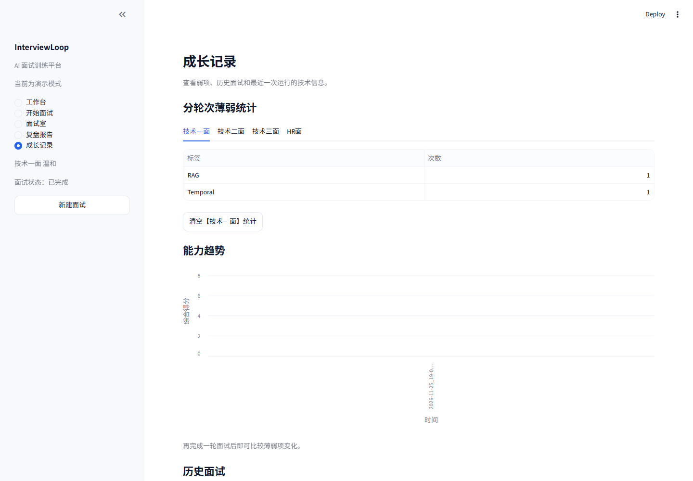
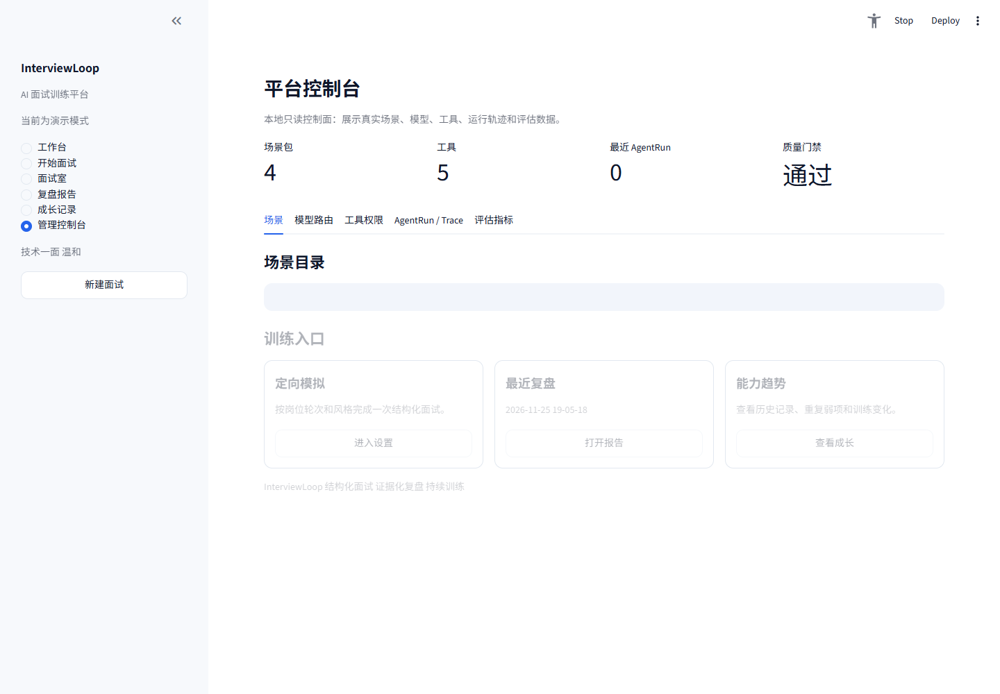

# InterviewLoop

**面向技术岗位的结构化 AI 面试训练平台。**
把一次模拟面试拆成可配置的轮次、阶段、主问题、追问和时间预算，并输出完整的问答记录、结构化复盘和成长趋势。


> 当前版本：`v0.16.0`。项目可作为本地面试训练工具、Agent 工程作品和受控演示使用；公测生产环境仍需补齐账号、数据库、安全和运营能力。

## 解决什么问题

传统面试准备通常依赖题库、面经或真人陪练：

- 题库缺少目标岗位和个人简历上下文；
- 通用 AI 聊天没有稳定的阶段和题目预算；
- 真人模拟成本高、难预约；
- 面试结束后缺少完整记录和可执行复盘。

InterviewLoop 把 JD、简历、阶段状态机、动态追问、语音/文字作答、结构化评分、成长记录和 Markdown 导出连接成一个可重复训练的闭环。

## 核心能力

- **五视图产品壳**：工作台、三步设置、专注面试室、复盘报告、成长记录。
- **4 个面试轮次**：技术一面、技术二面、技术三面、HR 面。
- **配置化面试引擎**：每轮 6 个阶段，主问题数量、追问上限和时间预算来自版本化场景包。
- **JD + 简历匹配**：识别已匹配技能、缺失技能、风险和针对性面试重点。
- **语音/文字双输入**：安静环境可使用文字回答，两种输入共用同一状态机。
- **结构化复盘**：综合得分、维度评分、证据、优势、风险、行动计划和薄弱标签。
- **完整记录闭环**：保存 JSON 和 Markdown，支持历史记录、弱项统计和成长趋势。
- **RAG 降级**：本地向量模型可用时使用 FAISS + BM25，否则自动回退 BM25。
- **模型网关**：任务路由、重试、Provider 回退、熔断、Token/成本预算和租户额度。
- **工具运行时**：权限、超时、幂等、参数冲突、Schema 校验和 AgentRun 审计。
- **可观测与评估**：P50/P95、失败/重试、重复问题率、阶段遵守率、Trace Replay 和质量校准。
- **受控平台控制台**：只读展示场景、模型、工具、额度、运行轨迹和评估指标。

## 产品截图

<table>
  <tr>
    <td width="50%"></td>
    <td width="50%"></td>
  </tr>
  <tr>
    <td></td>
    <td></td>
  </tr>
  <tr>
    <td></td>
    <td></td>
  </tr>
</table>

更多素材：[demo/README.md](demo/README.md)

## 架构

```text
Streamlit 候选人 UI / 只读控制台
  │
  ├── 版本化场景注册表
  ├── 确定性面试状态机
  ├── JD / 简历匹配 + RAG
  ├── 语音 / 文字作答
  ├── 结构化报告 + 成长闭环
  │
  ├──────────── FastAPI /v1/*
  │               ├── AgentRun + SSE
  │               ├── Model Gateway
  │               ├── Tool Runtime
  │               └── Metrics
  │
  └── DeepSeek 兼容模型 / 火山引擎 ASR/TTS

持久化：会话 JSON + Markdown + SQLite
```

采用**模块化单体 + 独立 API 垂直切片**：核心业务可测试，外部 Provider 可替换，暂不在需求未验证前拆微服务。

详细设计：

- [架构说明](docs/architecture.md)
- [面试引擎](docs/interview-engine.md)
- [评估体系](docs/evaluation.md)
- [运维手册](docs/operations.md)
- [全部文档](docs/README.md)
- [架构决策记录](docs/adr/)

## 快速开始

### 1. 安装

```powershell
python -m venv .venv
.\.venv\Scripts\Activate.ps1
pip install -r requirements.txt
```

### 2. 无 Key 体验 Demo

```powershell
$env:demo_mode="true"
python -m streamlit run app.py
```

访问 `http://localhost:8501`。Demo 模式使用固定题目和复盘，不调用真实模型或语音接口。

### 3. 使用真实 Provider

```powershell
Copy-Item .streamlit\secrets.toml.example .streamlit\secrets.toml
```

填写：

- `deepseek_api_key`
- `volc_api_key`，或 `volc_appid` + `volc_token`
- ASR/TTS 资源版本和音色配置

然后：

```powershell
python -m streamlit run app.py
```

完整配置说明见 [运维手册](docs/operations.md)。

### 4. 启用只读平台控制台

```powershell
$env:admin_mode="true"
python -m streamlit run app.py
```

## Docker

```powershell
Copy-Item .env.example .env
docker compose up --build
```

- 候选人界面：`http://localhost:8501`
- Agent API：`http://localhost:8000`
- OpenAPI：`http://localhost:8000/docs`

## Agent API

```bash
uvicorn interview_loop.api.main:app --reload
```

包含场景、岗位匹配、AgentRun、工具执行、指标、导出和 SSE 事件流。启用 `INTERVIEWLOOP_API_KEY` 后，`/v1/*` 请求需要 API Key、租户、用户和权限头。接口与鉴权细节见 [运维手册](docs/operations.md#8-agent-api)。

## 测试与质量

```powershell
pip install -r requirements-dev.txt
ruff check .
pytest -q
python scripts/evaluate_rag.py
python scripts/evaluate_quality.py
```

当前包含 126+ 个 pytest 用例，覆盖状态机、追问、场景配置、JD 匹配、结构化报告、Markdown 导出、存储、模型网关、工具运行时、API、隐私、Trace 和 Streamlit 全流程。

检索黄金集、Rubric、评分质量门禁和 Agent 指标说明见 [评估体系](docs/evaluation.md)。

## 重新生成演示素材

```powershell
python -m playwright install chromium
python scripts/capture_demo.py
```

脚本使用隔离数据库完成一次真实 Demo 流程，生成 `demo/screenshots/*.png` 和 `demo/interview-loop.gif`，不会修改真实训练数据。详见 [demo/README.md](demo/README.md)。

## 项目文档

| 文档 | 内容 |
|---|---|
| [产品概览](docs/product/overview.md) | 定位、用户、价值和边界 |
| [使用指南](docs/product/user-guide.md) | 从设置到报告和成长记录 |
| [面试引擎](docs/interview-engine.md) | 场景、状态机、追问、输入和输出 |
| [架构说明](docs/architecture.md) | 模块、运行链路、数据和部署 |
| [评估体系](docs/evaluation.md) | 检索、报告、质量校准和 Trace |
| [运维手册](docs/operations.md) | 配置、启动、API、数据和故障排查 |
| [产品路线图](docs/product/roadmap.md) | 已完成范围与公测门槛 |
| [ADR](docs/adr/) | 关键技术决策 |

## 当前边界

- 评分用于训练反馈，不构成真实招聘决策或录用承诺。
- Demo 模式用于展示和测试，不代表真实模型质量。
- 当前 SQLite 与文件存储适合本地和 CI，不直接适合多实例公网服务。
- 不要提交真实简历、录音、API Key 或面试记录。
- 公开部署前必须完成账号、租户、数据库、限流、监控、隐私和成本治理。

下一阶段范围见 [产品路线图](docs/product/roadmap.md)。

## License

[MIT](LICENSE)
