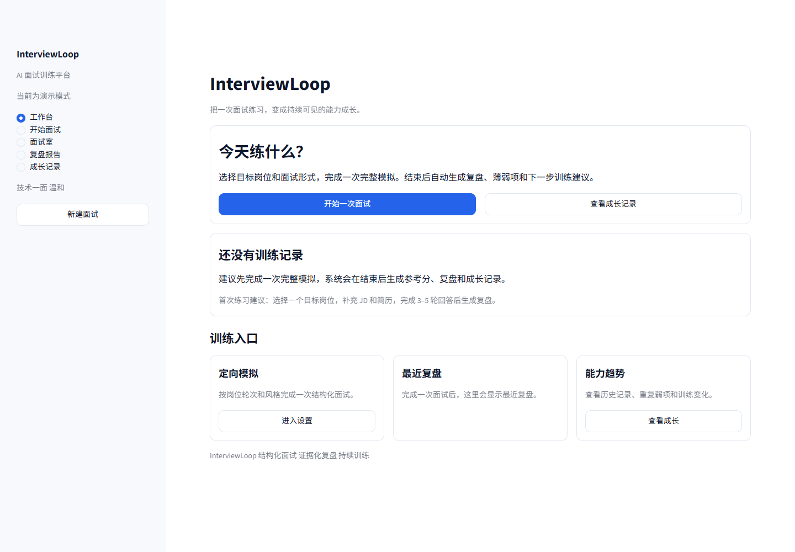
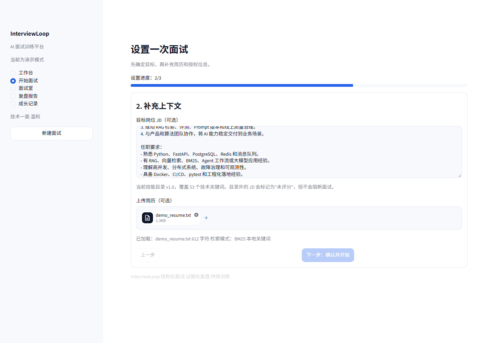
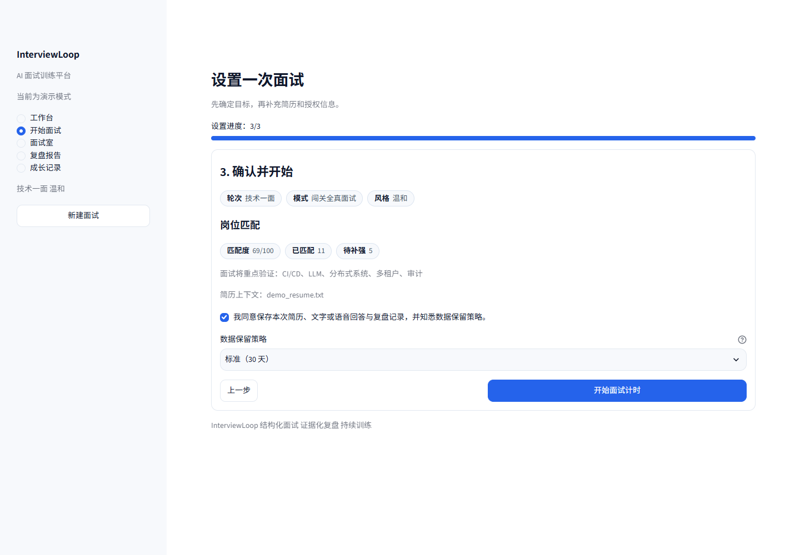
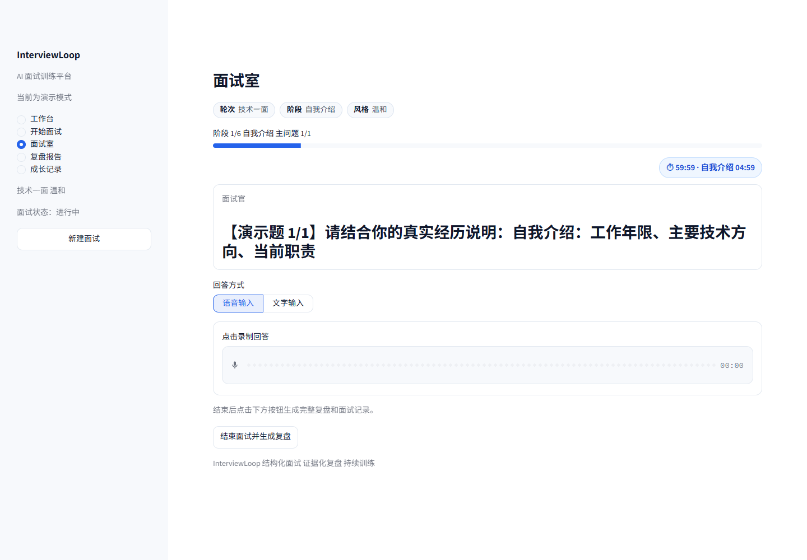
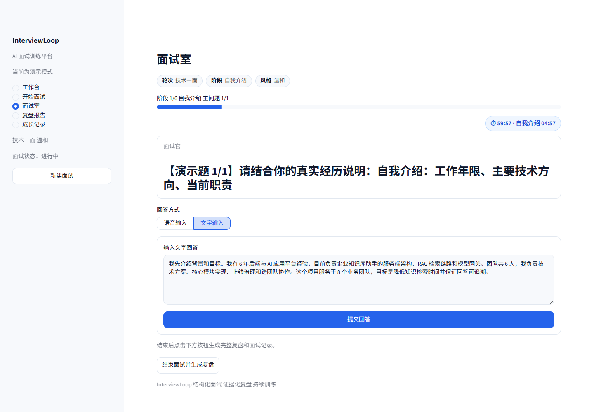
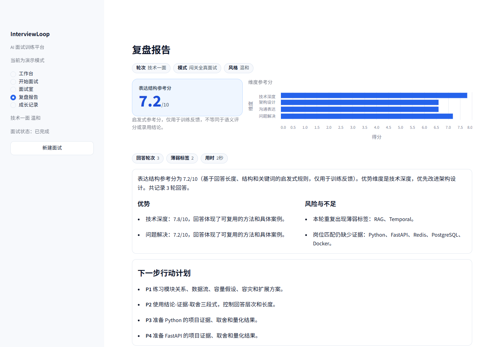
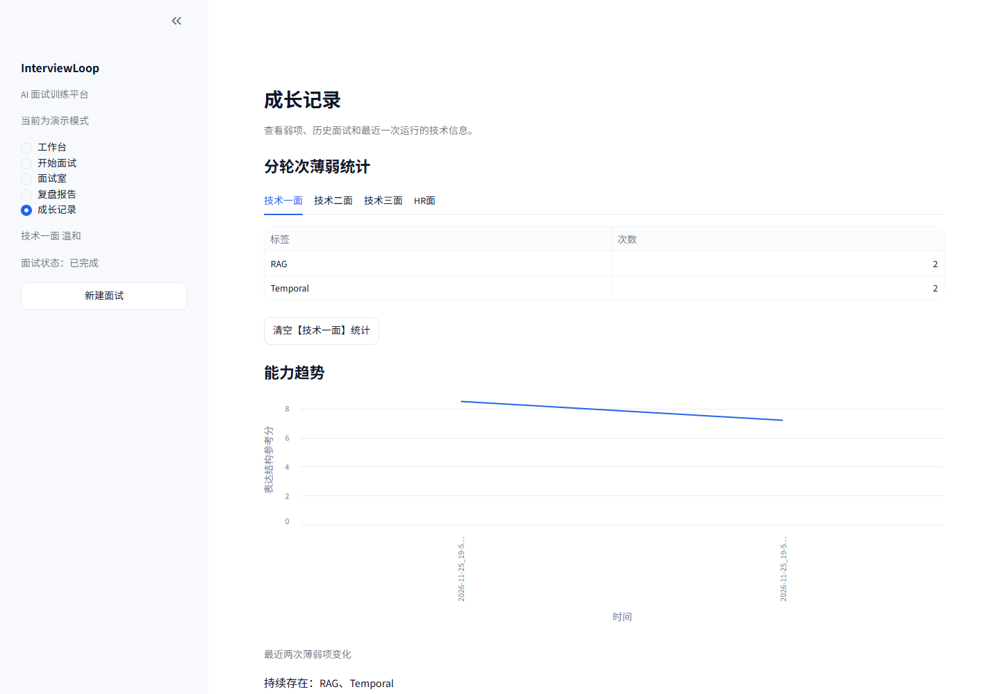
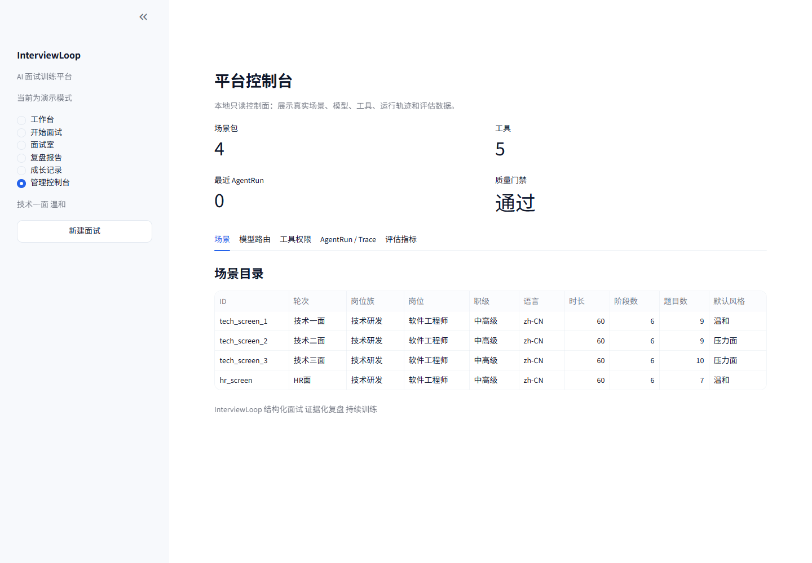

# 使用指南

## 1. 开始前

准备：

- 目标岗位 JD，可选但推荐；
- TXT、Markdown 或 PDF 简历，可选；
- 麦克风，可选；不方便说话时可以直接使用文字输入。

不需要 API Key 也可以先运行 Demo 模式体验完整流程。

## 2. 工作台



工作台显示历史训练次数、当前轮次、最近得分和弱项记录。点击“开始一次面试”进入三步设置。

## 3. 三步设置

### 第一步：选择目标

选择：

- 面试轮次：技术一面、技术二面、技术三面或 HR 面；
- 面试模式：闯关全真面试或薄弱专项练习；
- 面试官风格：温和或压力面。

### 第二步：补充上下文



可以粘贴目标岗位 JD，并上传简历。

- 粘贴 JD 后会计算技能匹配、缺失技能和面试重点。
- 上传简历后会解析文本并构建本地检索索引。
- 不上传简历也可以开始，但岗位匹配和个性化问题会更弱。

### 第三步：确认并开始



确认轮次、模式和风格，阅读数据保存说明并勾选同意，然后点击“开始面试计时”。

## 4. 面试室



面试室显示：

- 当前阶段和阶段进度；
- 当前主问题进度；
- 追问次数；
- 总剩余时间和当前阶段剩余时间；
- 面试官问题；
- 语音或文字输入。

### 文字回答

1. 在“回答方式”中选择“文字输入”。
2. 在文本框中输入回答。
3. 点击“提交回答”。
4. 系统根据回答长度、终止关键词和追问上限决定下一步。



### 语音回答

1. 保持“语音输入”。
2. 点击录音并按正常语速回答。
3. 录音完成后自动进行 ASR 转写。
4. 转写结果进入同一套状态机。

如果语音服务不可用，切换到文字输入即可继续。每轮成功回答后系统会自动保存草稿；刷新或重新进入时，工作台会提示恢复或放弃未完成面试。

## 5. 结束面试

以下任一方式可以结束：

- 完成所有阶段后点击结束；
- 在任意时刻点击“结束面试并生成复盘”；
- 在文字或语音回答中明确说“结束面试”。

系统会生成结构化报告、薄弱标签、完整问答记录和 Markdown 文件。

## 6. 复盘报告



报告包括：

- 表达结构参考分（启发式，仅作训练辅助）；
- 各能力维度得分；
- 优势；
- 风险与不足；
- 下一步行动计划；
- 回答证据；
- 岗位匹配摘要；
- 薄弱标签；
- 完整记录下载。

结构化报告不会因为模型复盘失败而丢失；启发式参考分和会话记录仍会保留。面试官总评只提供定性反馈，不再输出第二套数字分数。

## 7. 成长记录



成长页用于查看：

- 历史训练记录；
- 得分趋势；
- 重复出现的薄弱标签；
- 新出现、已解决和持续存在的问题。

旧版记录没有结构化参考分时会安全跳过趋势计算，但仍可打开原报告。历史记录支持 Markdown 下载；删除必须在二次确认后执行。

## 8. 面试记录文件

默认保存到：

```text
面试记录/
```

命名格式：

```text
准确时间+面试轮次+面试模式+面试风格.md
```

文件中包含完整的面试官问题、候选人回答、复盘和行动建议。数据保存在本地；不同机器的记录不会自动同步。

## 9. 隐私与数据

开始面试前必须勾选数据保存同意。可选择：

- `ephemeral`：约 1 天；
- `standard`：约 30 天；
- `extended`：约 365 天。

不要上传与训练无关的敏感信息。真实简历、录音和面试记录不应提交到公开仓库。

## 10. 平台控制台

启用 `admin_mode=true` 后，侧边栏会出现“管理控制台”。



控制台是只读视图，用于展示场景、模型路由、工具权限、租户额度、AgentRun Trace 和评估指标，不参与候选人主流程。
